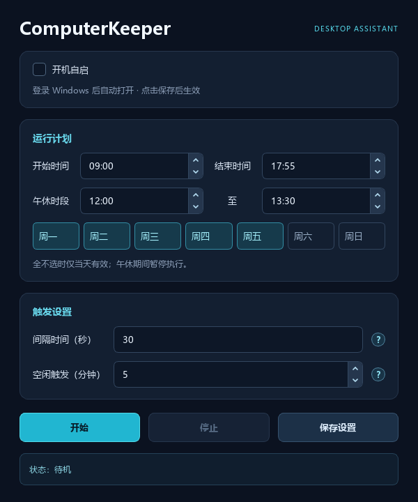
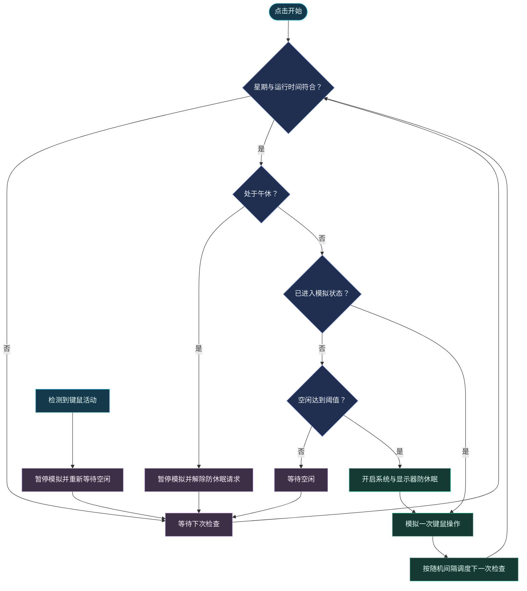
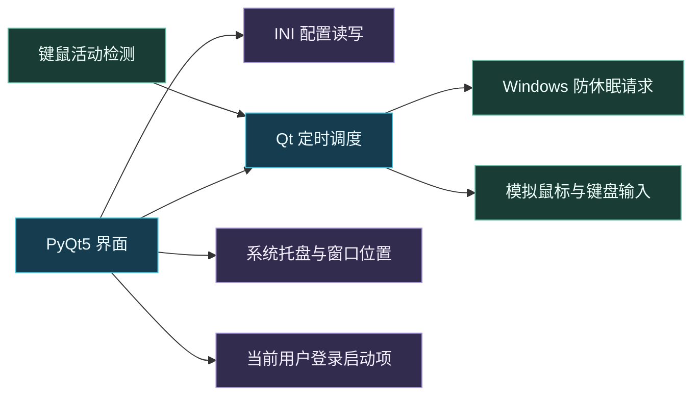

<div align="center">
  
  <h1>ComputerKeeper</h1>
  <p>🖥️ 桌面唤醒助手 · ⏱️ 定时执行 · 🌙 午休暂停 · 💾 配置保存</p>
  <p>基于 Python / PyQt5 的 Windows 桌面工具</p>
</div>

## ✨ 功能概览

| 功能 | 说明 |
| --- | --- |
| ⏰ 运行计划 | 设置开始、结束时间，选择周一至周日 |
| ☕ 午休暂停 | 午休期间暂停模拟操作，并解除防休眠请求 |
| 🖱️ 空闲触发 | 达到设定的键鼠空闲时间后再开始模拟 |
| 🎲 随机间隔 | 随机模拟鼠标微移、滚轮或 Shift 按键 |
| 💾 手动保存 | 全部界面设置保存到程序同目录 INI |
| 🚀 开机自启 | 勾选并保存后，Windows 登录时自动打开程序 |
| 📍 位置记忆 | 首次居中打开，后续恢复上次窗口位置 |
| 🎨 深色界面 | 青蓝强调色、分区卡片、圆圈问号悬停说明 |
| 📥 托盘运行 | 关闭窗口隐藏到托盘，右键可显示或退出 |

## 🖼️ 界面预览



## 🚀 快速使用

打开程序，调整运行时间、午休、星期和触发参数，点击 **开始** 即使用当前设置。

点击 **保存设置** 可保留这些参数，下次启动自动恢复。仅修改界面、点击开始或退出，都不会自动保存 INI。

> 💡 **开始**负责执行当前设置，**保存设置**负责持久化。修改参数无需重启：先停止，修改后再开始。

| 操作 | 效果 |
| --- | --- |
| 开始 | 根据当前设置等待或执行模拟操作 |
| 停止 | 停止模拟，解除防休眠请求，允许重新编辑运行参数 |
| 保存设置 | 写入 INI，并同步开机自启选项 |
| 悬停圆圈问号 | 查看间隔时间、空闲触发的具体含义 |
| 关闭窗口 | 隐藏到托盘，保持当前运行状态 |
| 托盘右键 → 退出 | 退出程序 |

### ⏱️ 两个触发参数

| 参数 | 作用 | 示例 |
| --- | --- | --- |
| 空闲触发（分钟） | 连续无键鼠操作多久后才进入模拟状态 | 5 分钟：空闲达到阈值后触发 |
| 间隔时间（秒） | 进入模拟状态后，两次模拟操作之间的间隔 | 30 秒：实际约 21～39 秒一次 |

实际模拟间隔为 `max(设定秒数, 3) × 0.7～1.3`。等待空闲时约每 15 秒检查一次，因此达到阈值后不会保证立刻触发；运行时段外或午休期间约每 60 秒检查一次。

> 📅 勾选星期时，程序按所选星期持续调度；全不选时仅当天有效，当天结束后自动停止，需要手动重新开始。开始到结束不支持跨午夜，时长至少 10 分钟，且不能短于空闲触发时间。

### 🚀 开机自启

勾选最前面的 **开机自启**，点击 **保存设置** 后启用；取消勾选并保存后移除。仅勾选或取消，不会立即修改系统设置。

启动项写入当前用户的 Windows 注册表，无需管理员权限。它在登录后打开软件，**不会自动点击开始**。

程序移动位置后，需要在新位置重新保存启动设置。复制 INI 不会自动添加启动项，界面勾选状态以当前程序路径的实际注册情况为准。

## 💾 配置存储

| 数据 | 保存位置 | 写入时机 |
| --- | --- | --- |
| 时间、间隔、星期、空闲触发与自启选项 | EXE 同目录的 `ComputerKeeper.ini` | 点击保存设置 |
| Windows 登录启动项 | `HKEY_CURRENT_USER\Software\Microsoft\Windows\CurrentVersion\Run` 下的 `ComputerKeeper` | 点击保存设置 |
| 窗口位置与大小 | `HKEY_CURRENT_USER\Software\ComputerKeeper\Window` | 隐藏到托盘或正常退出 |

直接运行源码时，INI 位于 `ComputerKeeper.py` 同目录。没有 INI 时使用内置默认值，不自动创建文件；缺失或无效的时间、数值项保留默认值。程序目录需要有写入权限。

默认配置示例（`day_1` 至 `day_7` 对应周一至周日）：

```ini
[time]
start_time=09:00
end_time=17:55
lunch_start=12:00
lunch_end=13:30

[activity]
interval_seconds=30
idle_minutes=5

[weekdays]
day_1=true
day_2=true
day_3=true
day_4=true
day_5=true
day_6=false
day_7=false

[startup]
enabled=false
```

`startup/enabled` 记录保存时的选项；实际自启由 Windows 启动项决定，直接修改 INI 不会注册或删除启动项。

## 🔄 工作流程



## 🧩 核心原理



防休眠使用 `SetThreadExecutionState`；模拟输入使用 Windows 的 `mouse_event`、`keybd_event`。空闲检测优先使用 Raw Input，注册失败时回退到 `GetLastInputInfo`。

程序通过系统唤醒和输入活动影响桌面空闲状态，不调用企业微信、钉钉的内部接口，也不直接修改它们的在线状态。具体在线显示取决于客户端自身的判断逻辑。模拟输入会作用于当前桌面，滚轮或 Shift 可能影响当前应用。

## 🛠️ 源码运行与打包

在 Windows PowerShell 中克隆当前仓库：

```powershell
git clone https://github.com/GAATTC0/ComputerKeeper.git
cd ComputerKeeper
python -m pip install PyQt5 PyInstaller
```

运行源码：

```powershell
python .\ComputerKeeper.py
```

在仓库根目录打包单文件 EXE：

```powershell
python -m PyInstaller --noconfirm -F -w --icon icon.ico --add-data "icon.png;." --add-data "assets;assets" ComputerKeeper.py
```

产物位于 `dist/ComputerKeeper.exe`，中间文件位于 `build/`。当前已在 Windows 11、Python 3.14.3、PyQt5 5.15.11、PyInstaller 6.22.3 环境完成打包。

| 文件 | 用途 |
| --- | --- |
| `ComputerKeeper.py` | 界面、配置、调度和系统交互 |
| `icon.ico` | Windows EXE 文件图标 |
| `icon.png` | 应用窗口、任务栏与托盘图标 |
| `icon.svg` | 图标矢量源文件 |
| `assets/chevron-*.svg` | 深色输入框的上下箭头 |
| `img.png` | README 界面预览 |

> 🎨 修改图标后重新打包；`icon.ico` 和 `icon.png` 分别影响 EXE 外观与应用运行时图标。
